# WERIT Connect – Datenmodell (Phase 2)

Status: Entwurf v0.1 · Stand 20.10.2026
Basis: `01-architektur.md` (v0.3) · Umsetzung: `backend/migrations/001_initial_schema.sql`

---

## 1. Grundsätze

| Thema | Regel |
|---|---|
| Datenbank | PostgreSQL 16 (Azure Database for PostgreSQL Flexible Server), Erweiterungen `vector` und `pg_trgm` |
| Schlüssel | `uuid` (`gen_random_uuid()`), keine fortlaufenden IDs nach außen |
| Zeitstempel | `timestamptz`, immer UTC gespeichert. `created_at` und `updated_at` pflegt ein Trigger. |
| Löschen | Fachdaten, die offline synchronisiert werden, werden **weich** gelöscht (`deleted_at`), damit die App Löschungen per Delta-Sync erkennt. Benutzer werden über `is_active = false` deaktiviert. |
| Delta-Sync | Offlinefähige Tabellen haben `updated_at` mit Index. Die App fragt `?updated_since=<Zeitstempel>` ab. |
| Mehrsprachigkeit | Inhalte liegen in `*_translations`-Tabellen je Sprache. Sprachen stehen in `languages`, weitere werden per `INSERT` ergänzt. Fallback ist Deutsch. |
| Idempotenz | Offline erzeugte Aktionen tragen einen Client-Schlüssel (`client_event_id`, `client_request_id`), damit Wiederholungen keine Duplikate erzeugen. |
| Datenschutz | Geburtstag nur als Tag und Monat und nur mit Einwilligung (`show_birthday`). Verzeichnisanzeige abschaltbar (`show_in_directory`). |
| Quelle der Wahrheit | Benutzer, Rollen und Organisation: Entra ID. Dokumente: SharePoint. Tickets: NinjaOne (später). Die Datenbank hält Spiegel und App-eigene Daten. |

## 2. ER-Diagramm (Überblick)

```mermaid
erDiagram
    languages ||--o{ users : "Sprache"
    locations ||--o{ users : "Standort"
    departments ||--o{ users : "Abteilung"
    departments ||--o{ departments : "Eltern"
    users ||--o{ users : "Vorgesetzter"
    users ||--o{ user_roles : "hat"
    departments ||--o{ user_roles : "Zuständigkeit"
    role_permissions }o--|| permissions : "enthält"

    users ||--o{ devices : "besitzt"
    users ||--o{ notification_preferences : "stellt ein"
    notifications ||--o{ notification_recipients : "an"
    users ||--o{ notification_recipients : "erhält"
    notifications ||--o{ notification_deliveries : "Zustellung"
    devices ||--o{ notification_deliveries : "auf"

    users ||--o{ posts : "verfasst"
    posts ||--o{ post_translations : "Texte"
    users ||--o{ tasks : "zugewiesen"
    users ||--o{ tickets : "meldet"
    users ||--o{ approvals : "beantragt/entscheidet"

    documents ||--o{ document_reads : "gelesen"
    users ||--o{ document_reads : "liest"

    safety_instructions ||--o{ safety_instruction_translations : "Texte"
    safety_instructions ||--o{ safety_acknowledgements : "bestätigt"
    users ||--o{ safety_acknowledgements : "bestätigt"

    locations ||--o{ emergency_contacts : "gilt für"
    emergency_contacts ||--o{ emergency_contact_translations : "Texte"

    rag_sources ||--o{ rag_documents : "enthält"
    rag_documents ||--o{ rag_chunks : "zerlegt in"
    users ||--o{ assistant_conversations : "führt"
    assistant_conversations ||--o{ assistant_messages : "enthält"

    users ||--o{ audit_log : "löst aus"
```

## 3. Tabellen nach Modul

### 3.1 Stammdaten und Organisation

| Tabelle | Zweck | Wichtige Spalten |
|---|---|---|
| `languages` | Unterstützte Sprachen | `code` (de, en, fr), `is_enabled` |
| `locations` | Standorte | `name`, Adresse, `timezone` |
| `departments` | Abteilungen, hierarchisch | `parent_id` |
| `users` | Spiegel aus Entra ID | `entra_object_id`, `email`, `display_name`, `department_id`, `location_id`, `manager_id`, `language`, `show_birthday`, `is_active` |

### 3.2 Rollen und Berechtigungen

| Tabelle | Zweck |
|---|---|
| `permissions` | Benannte Berechtigungen |
| `role_permissions` | Zuordnung Rolle → Berechtigungen (vorbelegt) |
| `user_roles` | Rolle je Benutzer, optional mit Zuständigkeitsbereich (`department_id`), `source` = `entra` oder `manual` |

Jeder aktive Benutzer ist implizit Mitarbeiter. Die effektiven Berechtigungen sind die Vereinigung aller seiner Rollen. Teamleiter und Manager erteilen Freigaben nur im Bereich ihres `department_id` bzw. für ihr Team (Beziehung `users.manager_id`).

Vorbelegung entsprechend der Matrix in der Architektur (5.3):

| Berechtigung | Mitarbeiter | Teamleiter | Manager | Administrator |
|---|:-:|:-:|:-:|:-:|
| `content.read` | ✓ | ✓ | ✓ | ✓ |
| `assistant.use` | ✓ | ✓ | ✓ | ✓ |
| `ticket.create` | ✓ | ✓ | ✓ | ✓ |
| `approval.decide` | – | ✓ | ✓ | – |
| `post.publish` | – | – | ✓ | ✓ |
| `security_alert.publish` | – | – | ✓ | ✓ |
| `admin.manage` | – | – | – | ✓ |

### 3.3 Dashboard-Inhalte

| Tabelle | Zweck | Hinweis |
|---|---|---|
| `posts`, `post_translations` | Unternehmensnews und wichtige Ankündigungen | `type` = `news` oder `announcement`, `priority`, Veröffentlichung und Ablauf, Zielgruppe nach Standort und Abteilung |
| `tasks` | Persönliche Aufgaben | optionaler Bezug über `ref_type`/`ref_id`, z. B. offene Sicherheitsunterweisung |
| `tickets` | Eigene Tickets | **Platzhalter**, NinjaOne-Anbindung später. `client_request_id` für Offline-Meldung |
| `approvals` | Freigaben | **Platzhalter**, Datenquellen später |

Geburtstage und neue Mitarbeiter haben keine eigene Tabelle. Sie werden aus `users` abgeleitet:

- Geburtstage: `show_birthday = true` und `birth_day`/`birth_month` im gewünschten Zeitraum.
- Neue Mitarbeiter: `hire_date` innerhalb der letzten 30 Tage (Wert konfigurierbar).

„Offene Urlaubsanträge“ entfällt. Urlaub ist nur ein Link zu VEDA.net, gespeichert in `app_settings` unter `links.veda`. Die URL ist derzeit ein Platzhalter.

### 3.4 Offlinefähige Inhalte

| Tabelle | Zweck | Offline-Hinweis |
|---|---|---|
| `users` | Mitarbeiterverzeichnis | Volltext lokal in SQLite (FTS5), Delta über `updated_at` |
| `documents`, `document_reads` | Dokument-Metadaten und zuletzt gelesene Dokumente | Dateien liegen im App-Speicher, `document_reads` gleicht die Verlaufsliste zwischen Geräten ab |
| `safety_instructions`, `safety_instruction_translations` | Sicherheitsunterweisungen | `version` steigt bei Änderung, die App prüft die Version |
| `safety_acknowledgements` | Lesebestätigungen | `acknowledged_at` ist die Gerätezeit, `received_at` der Eingang im Backend, `client_event_id` verhindert Dubletten, eindeutig je Benutzer, Unterweisung und Version |
| `emergency_contacts`, `emergency_contact_translations` | Notfallkontakte je Standort | höchste Offline-Priorität |

### 3.5 Push und Benachrichtigungen

| Tabelle | Zweck |
|---|---|
| `devices` | Geräte mit Push-Token, Plattform, App- und OS-Version, Intune-Geräte-ID |
| `notification_preferences` | Einstellung je Benutzer und Kategorie. Die Kategorie `security_alert` ist per Constraint immer aktiv. |
| `notifications` | Meldung mit Texten je Sprache als JSON, Deutsch ist Pflicht |
| `notification_recipients` | Posteingang je Benutzer mit `delivered_at` und `read_at` |
| `notification_deliveries` | Zustellprotokoll je Gerät (`sent`, `failed`, `invalid_token`) |

Kategorien: `news`, `it_incident`, `security_alert`, `approval`.

### 3.6 KI-Assistent (RAG)

| Tabelle | Zweck |
|---|---|
| `rag_sources` | Konfigurierte Quellen (z. B. SharePoint) |
| `rag_documents` | Indizierte Dokumente mit `content_hash` für Änderungserkennung und Zugriffsfiltern (`allowed_roles`, `allowed_location_ids`, `allowed_entra_groups`) |
| `rag_chunks` | Textabschnitte mit Vektor (`vector(1536)`, HNSW-Index, Cosine-Distanz) |
| `assistant_conversations`, `assistant_messages` | Verlauf mit Quellenangaben und Daumen-Feedback, Löschfrist über `expires_at` |

Retrieval filtert **vor** der Ähnlichkeitssuche auf die Berechtigungen des Fragenden. Ein `NULL`-Wert in einem Zugriffsfilter bedeutet keine Einschränkung. Die Dimension 1536 passt zu `text-embedding-3-small` in Azure OpenAI. Bei anderem Modell ist eine Neuindizierung nötig.

### 3.7 Einstellungen und Audit

| Tabelle | Zweck |
|---|---|
| `app_settings` | Schlüssel-Wert-Einstellungen, vorbelegt mit `links.veda` |
| `audit_log` | Protokoll sicherheits- und verwaltungsrelevanter Aktionen (Veröffentlichungen, Freigaben, Rollenänderungen) |

## 4. Aufbewahrung und Löschung (Vorschlag, mit Datenschutz abstimmen)

| Daten | Frist | Umsetzung |
|---|---|---|
| Assistent-Verlauf | 90 Tage | Nächtlicher Job löscht Konversationen mit `expires_at` in der Vergangenheit |
| Zustellprotokoll Push | 90 Tage | Nächtlicher Job |
| Posteingang | 12 Monate | Nächtlicher Job |
| Lesebestätigungen Sicherheit | gemäß Arbeitsschutz-Vorgaben | Nicht automatisch löschen, Frist klären |
| Audit-Log | 24 Monate | Nächtlicher Job |
| Deaktivierte Benutzer | nach Austritt anonymisieren | Frist klären |

## 5. Hinweise zur Umsetzung

- **Migration:** `001_initial_schema.sql` im Format von `node-pg-migrate` (`-- Up Migration` / `-- Down Migration`).
- **Azure:** Die Erweiterungen `vector` und `pg_trgm` müssen im Serverparameter `azure.extensions` freigegeben sein, bevor die Migration läuft.
- **Test:** Die Migration wurde noch nicht gegen eine Datenbank ausgeführt. Das geschieht beim Aufbau der Docker-Umgebung (Phase 5).
- **Platzhalter:** `tickets` und `approvals` sind bewusst minimal gehalten. Sie werden erweitert, sobald NinjaOne und die Freigabequellen definiert sind.
- **Rollen aus Entra:** Beim Login gleicht das Backend `user_roles` mit `source = 'entra'` anhand der App-Rollen im Token ab. Manuell vergebene Rollen (`source = 'manual'`) bleiben unberührt.

## 6. Offene Punkte

1. Aufbewahrungsfristen (Abschnitt 4) mit Datenschutz und Betriebsrat abstimmen.
2. Genaue URL von VEDA.net in `app_settings` eintragen.
3. NinjaOne- und Freigabe-Felder ergänzen, sobald definiert.
4. Entra-Rollenkonzept (App Roles oder Gruppen) mit der IT festlegen.
